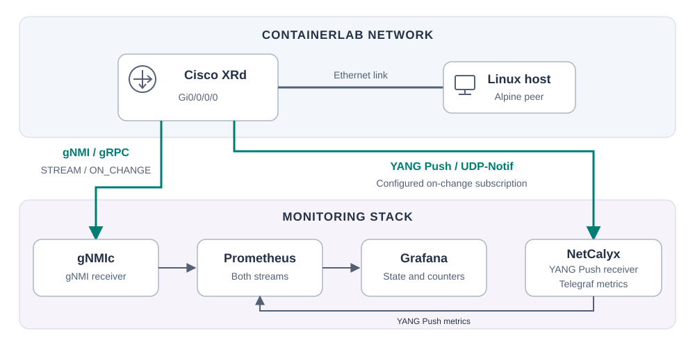

# Show a real gNMI interface event

Log in to a Nokia SR Linux router, disable an interface, and watch gNMI report
DOWN. Enable it again and watch UP arrive. SNMP polling and Grafana run in the
background. All protocol messages and interface states come from the real router.



## Start before presenting

**Codespaces:** [open the repository in Codespaces](https://codespaces.new/k-tsky/IBN-gNMI-YANG-demo?quickstart=1),
choose a 4-core machine and wait for **Lab ready**.

**Local Windows/macOS:** start Docker Desktop with Linux containers, open this
folder in VS Code, and choose **Dev Containers: Reopen in Container** using
Microsoft's Dev Containers extension. Wait for **Lab ready**.

**Local Linux:** with Docker, Docker Compose and Containerlab installed, run:

```bash
bash scripts/start.sh
```

Setup automatically starts the router, its Linux peer, the gNMI subscription,
SNMP polling, Prometheus and Grafana. Do this before class; initial downloads
and router startup can take several minutes.

Run the commands below in two terminals inside the development container or
Codespace, from this repository's directory. On local Linux, use the host terminals.

## Demo — 3–4 minutes

### 1. Show the received messages

Prepare this in Terminal 1 and leave it visible:

```bash
docker compose logs --follow --tail=20 --no-log-prefix gnmic
```

This displays the actual gNMI messages received by the already-running gNMIc
client. The initial `up` is the current state, not a change event.

Say: **“This client has subscribed to changes in ethernet-1/1's operational state.”**

### 2. Log in to the router

In Terminal 2:

```bash
ssh admin@clab-telemetry-srl
```

Password: `NokiaSrl1!`

Show the interface:

```text
show interface ethernet-1/1
```

Say: **“The interface is currently up. I'll shut it down on the router.”**

### 3. Shut down the interface

In the router CLI:

```text
enter candidate
/interface ethernet-1/1 admin-state disable
commit now
```

Pause about five seconds and point to **`down`** in Terminal 1.

Say: **“Changing the interface caused the router to send a gNMI update.
I did not send another request for its state.”**

SR Linux calls this `admin-state disable`; it is the equivalent of `shutdown`
on a Cisco-style CLI. `commit now` applies the candidate configuration.

#### Explain the received message — about 30 seconds

Use the live DOWN message in Terminal 1. This is an example from the lab;
your timestamps will differ:

```json
{
  "source": "clab-telemetry-srl:57400",
  "subscription-name": "interface-state",
  "timestamp": 1793742656108667462,
  "time": "2026-11-03T21:50:56.108667462Z",
  "updates": [
    {
      "Path": "srl_nokia-interfaces:interface[name=ethernet-1/1]/oper-state",
      "values": {
        "srl_nokia-interfaces:interface/oper-state": "down"
      }
    }
  ]
}
```

Point out four things:

| Field | What to say |
|---|---|
| `source` | “This identifies the router and its gNMI port.” |
| `timestamp` / `time` | “The notification has a timestamp; this is its readable UTC form.” |
| `Path` | “This selects ethernet-1/1's operational state. The prefix identifies the Nokia YANG module.” |
| `values` | “The router reported DOWN.” |

Say: **“The update tells us which device, which interface, what state, and when.”**

gNMI messages travel as Protocol Buffers over gRPC. This is gNMIc's JSON
presentation of the received message, with client metadata such as `source`
and `subscription-name`; it is not the literal wire encoding.

### 4. Bring it back up

In the router CLI:

```text
enter candidate
/interface ethernet-1/1 admin-state enable
commit now
```

Point to **`up`** in Terminal 1. This is the equivalent of `no shutdown`.

Close with: **“One subscription reported both changes: DOWN and UP.”**

### 5. Optional Grafana recap

Open port **3000** in the VS Code/Codespaces **Ports** tab, or
[localhost:3000](http://localhost:3000) locally. Show the interface timeline and
the observation counters. Keep this brief; the CLI messages are the main demo.

SNMP polls every ten seconds, while gNMI reports changes. A short outage may
fall between SNMP polls. Prometheus also samples gNMIc's latest state every
second, so very brief transitions may be absent from the plot even when the
gNMI messages and counters captured them.

## Useful notes

- No client configuration, Docker profiles, or gNMI Set commands are needed
  during the presentation. Only the router CLI changes the interface.
- If SSH is unavailable, enter the same router CLI with
  `docker exec -it clab-telemetry-srl sr_cli`.
- Ctrl+C in Terminal 1 stops viewing logs; it does **not** stop the subscription.
  Use `docker compose stop gnmic` if you want to stop collection.
- If interrupted with the interface down, repeat the enable block above.
- SNMP observation counters cover the selected Grafana time range. gNMI
  counters cover the receiver's current run, including the initial state but
  excluding sync-only messages. DOWN observations are not unique failures:
  a long outage can produce several SNMP DOWN polls.
- The receiver uses standard gNMIc outputs and filters. There is no custom
  Python collector. SNMP uses the standard Prometheus SNMP exporter.

## Restart, stop and troubleshoot

```bash
bash scripts/start.sh       # Recreate the lab and reset monitoring history
bash scripts/stop.sh        # Remove the lab and monitoring services
docker compose logs --tail=40 gnmic snmp-exporter prometheus
docker logs clab-telemetry-srl --tail=40
```

Startup runs automatically when the development container resumes. If Grafana
does not open, forward port 3000 in the **Ports** tab. Only Grafana is published;
exporter and management ports remain internal.

The router login and SNMP community (`telemetrylab`) are disposable lab
credentials. gNMI uses TLS with certificate verification skipped for the lab's
self-signed certificate. Grafana provides read-only anonymous access. Stop the
Codespace after use to conserve account quota.
